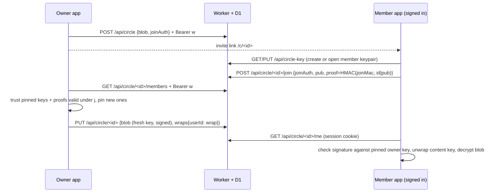

# Circle members with their own accounts

> updated 2026-10-11 · v2.5.0

A circle shares one profile live and read-only. New circles admit **members**: people with their own OAK account who join from an invite link. Each publish encrypts the snapshot with a fresh content key and wraps that key to every verified member's public key. Removing one member cuts them off from the next publish; the others keep reading. Older **bearer** circles (key in the link `#fragment`) keep working unchanged.

Since 2.5 the owner signs every member snapshot and members check it against a key pinned at join, and the owner's circle state follows the owner to every synced device.

Code: `lib/member-keys.ts` (pure crypto and merge rules, tested in `tests/circles.test.ts`), `lib/circles.ts` (client flows), `lib/sync.ts` (vault carries circle state), `worker/circles.ts` (API), `components/circle-view.tsx` (`/c/`), Settings → Circles.

## Keys

| Key | Made by | Stored | Server sees |
| --- | --- | --- | --- |
| Member keypair (ECDH P-256), one per account | member's first join or read | `member_keys`: public key (raw point, b64u) + private JWK sealed with AES-GCM | public key, ciphertext |
| Member seal key | HKDF(sync key, salt `oak-healthy-v1`, info `member-key`) | nowhere, derived on each unlocked device | never |
| Invite secret `j` (24 random bytes) | owner, per circle; replaced on every member removal (`epoch` + 1) | owner devices (`meta.circles`, vault), invite link `#j=` | never |
| `joinAuth` = HKDF(j, `join-auth`) | owner / joiner | `circles.join_hash` = SHA-256(joinAuth) | joinAuth in transit, hash at rest |
| `joinMac` = HKDF(j, `join-mac`) | owner / joiner | nowhere | never |
| Content key (AES-256-GCM) | owner, **new on every publish** | nowhere in plaintext | never |
| Wrap = ECIES(ephemeral P-256 × member pub → HKDF info `wrap:<circle>:<epk>` → AES-GCM) | owner | `circle_members.wrap` (`epk.iv.ct`) | ciphertext |
| Write token `w` | owner | owner devices (`meta.circles`, vault); server keeps SHA-256 | hash |
| Owner signing key (ECDSA P-256), one per circle | owner at circle creation; circles from before 2.5 on first publish or Settings open | private JWK in `meta.circles` + vault; public key in the invite `#o=` and in every member blob | public key, signatures |
| Owner key pin | member, from the invite `#o=` (or the first signed snapshot, see Migration) | member devices (`meta.circlePins`, vault) | never |

The private member key is sealed with a key derived from the OAK sync key, so every device where the account is unlocked can open it and the server cannot.

## Signatures

A member blob is `iv.ct.signerPub.sig`: `sig` = ECDSA-P256-SHA256 over `oak-circle-sig-v1|<circleId>|<signerPub>|iv.ct`. Bearer blobs stay `iv.ct`. The member refuses, with a notice on `/c/<id>`:
- a blob without a signature ("This circle update isn't signed by its owner, so it isn't shown.");
- a signer other than the pinned owner key, or a bad signature ("This circle update failed its signature check, so it isn't shown. Ask the owner for a new invite.").

The pin comes from the invite link (`#o=`), which the owner hands over out of band, so the server cannot swap it. The first blob (at creation) has no wraps and is never shown; every publish after it is signed. No server or schema change: the signature travels inside the existing `blob` string.

## Owner devices

`meta.circles` (write token, `j`, `epoch`, pins, signing key) and `meta.circlePins` ride in the encrypted vault snapshot (`lib/sync.ts`), so a second owner device can publish, remove members and copy the invite. The server sees only the sealed vault, as for health data. Merge rules (`mergeCircle`):
- a deleted circle stays as a tombstone without secrets and wins, so a stale device cannot revive it;
- `j` and its pins move only to a higher `epoch`; at the same epoch, pins are unioned and other fields follow the newer `updatedAt`;
- the signing key in the pulled vault wins over this device's.

Signing keys for circles from before 2.5 are created just before the sync agent's vault push (`ensureSigners`). With sync on, such a key is `pending`: it cannot sign and stays out of the invite `#o=` until a successful vault push carried it (`commitSigners`). Vault pushes are linear (`baseRev`), so if two owner devices both create one, the device that pushes second adopts the first device's key on its pull before it ever signs. No member can pin a key that later loses. Without sync there is no other device, so the key is usable at once. Keys made with a new circle are never pending, because no other device knows that circle yet.

Every meta write goes through `updateMeta`, a read-modify-write in one Dexie transaction. A publish writes back only the pins it verified, and only if the circle is still on the epoch it published under (`applyPins`). Before 2.5, an in-flight publish saved its whole stale copy after a removal had rotated `j`, so the stored invite stopped matching the server.

## Flows

- **Join**: needs a session and the invite link. The member app pins `#o=` for this circle. The page drops the fragment after joining; from then on `/c/<id>` reads with the session cookie, no key in the URL. Until the owner's next publish the member sees "waiting". Opening Settings on the owner device publishes right away when someone is waiting.
- **Publish**: the sync agent publishes every circle after local changes. Members not in `wraps` get `wrap = NULL` in the same batch.
- **Remove member**: the owner first re-reads its stored circle and the server's member list and pins every other member whose key is pinned or proven under the **current** `j` (joins not yet published-in included). Then `POST /revoke` deletes the row and replaces `join_hash` (a new `j`); the owner stores it at the next `epoch` and publishes with a new content key. Unused invite links stop working; copy the new one.
- **Delete circle**: `DELETE /api/circle/<id>` removes the circle and all member rows; the owner keeps a tombstone that syncs to its other devices.
- **Bearer circles**: `join_hash IS NULL`. `GET /api/circle/<id>` stays public and returns the blob for the `#key` holder. Member circles answer that route with 403.

## Threat model

| Attacker | Gets | Does not get |
| --- | --- | --- |
| Server / D1 dump | ciphertext, member public keys, member emails (from `users`), who is in which circle, publish times | health data, any private or content key, `j`, `joinMac` |
| Malicious server adds its own key as a member | nothing: the owner wraps only to keys pinned earlier or carrying a valid `joinMac` proof, and the server never sees `joinMac` | |
| Malicious server swaps a pinned member's key | nothing: a pinned user's key must match the pin | |
| Malicious server forges a snapshot for a member (own content key wrapped to the member's public key) | a refusal notice on the member's screen: it cannot sign as the owner | |
| Removed member | the snapshots published before removal (already readable to them) | anything published after; the old invite link (replaced) |
| Someone with a leaked invite link (before it is replaced) | can join; the owner sees their email in Settings and can remove them | |

Open limits:
- **Members who joined before 2.5** pin the signer of the first signed snapshot they see (trust on first use). A server that forges that very first snapshot wins the pin; a fresh invite link (with `#o=`) re-pins the real key.
- **Replay**: the server can serve an older, genuinely signed snapshot (its date shows on the page). Members do not yet refuse snapshots older than one already seen.
- **Two owner devices removing members while offline** reach the same `epoch`; the newer edit's `j` wins locally while the server keeps the last `POST /revoke`, so the invite link can mismatch until the next removal.
- **A vault push without circle state** (service worker or a 2.4 client) can hide a pending signing key from the other device, which may then commit its own. The service worker must pass `circles`/`circlePins` through its vault push (`public/sw.js`).
- **Sync key rotation** (password reset without recovery code): the stored member private key no longer opens. Reading never replaces it (the error asks for a new invite); only an explicit join creates a new keypair, so the member rejoins from a fresh invite link.
- **An invite link is a join capability**: anyone holding it can join with any account, and the owner app admits them on its next publish. The owner sees each member's email and can remove them.

Account deletion removes the account's `member_keys` and `circle_members` rows.

## Limits

- 20 members per circle; joins, key writes: 20 per account per hour; circle creation: 20 per IP per hour.
- Blob ≤ 400 000 chars; wrap 100–400; public key 80–100; proof 40–50; sealed key ≤ 2000.
- All `/api/circle*` writes require a same-origin `Origin` header, as `/api/auth`.

## Migration

`worker/migrations/0004_circle_members.sql` adds `circles.join_hash`, `member_keys` and `circle_members`. Existing rows get `join_hash = NULL` and stay bearer circles; no client change is needed for them. New invites from Settings are member circles.

2.5 needs no migration. Stored circles without `epoch`/`updatedAt` count as epoch 0, last edited at `createdAt`. A pre-2.5 member circle gets its signing key when Settings shows it or on its next publish; copy the invite again to hand out `#o=`. Members who joined earlier keep reading: they pin the first signed snapshot (see Open limits). A snapshot from an owner app still on 2.4 is unsigned and is refused until that app updates and publishes.
