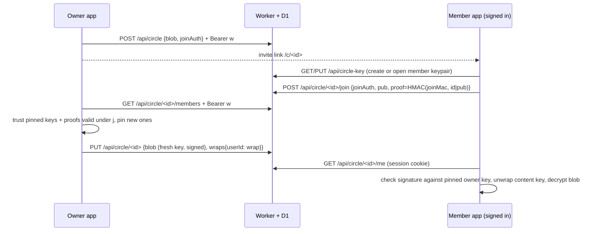

# Circle members with their own accounts

> updated 2026-10-11 · v2.6.0

A circle shares one profile live and read-only. New circles admit **members**: people with their own OAK account who join from an invite link. Each publish encrypts the snapshot with a fresh content key and wraps that key to every verified member's public key. Removing one member cuts them off from the next publish; the others keep reading. Older **bearer** circles (key in the link `#fragment`) keep working unchanged.

Since 2.5 the owner signs every member snapshot and members check it against a key pinned at join, and the owner's circle state follows the owner to every synced device. Since 2.6 the server keeps each circle's epoch, so two owner devices cannot leave the invite out of step, and members refuse a replayed older snapshot.

Code: `lib/member-keys.ts` (pure crypto and merge rules, tested in `tests/circles.test.ts`), `lib/circles.ts` (client flows), `lib/sync.ts` (vault carries circle state), `worker/circles.ts` (API), `components/circle-view.tsx` (`/c/`), Settings → Circles.

## Keys

| Key | Made by | Stored | Server sees |
| --- | --- | --- | --- |
| Member keypair (ECDH P-256), one per account | member's first join or read | `member_keys`: public key (raw point, b64u) + private JWK sealed with AES-GCM | public key, ciphertext |
| Member seal key | HKDF(sync key, salt `oak-healthy-v1`, info `member-key`) | nowhere, derived on each unlocked device | never |
| Invite secret `j` (24 random bytes) | owner, per circle; replaced on every member removal (server `epoch` + 1, § Epoch) | owner devices (`meta.circles`, vault), invite link `#j=` | never |
| `joinAuth` = HKDF(j, `join-auth`) | owner / joiner | `circles.join_hash` = SHA-256(joinAuth) | joinAuth in transit, hash at rest |
| `joinMac` = HKDF(j, `join-mac`) | owner / joiner | nowhere | never |
| Content key (AES-256-GCM) | owner, **new on every publish** | nowhere in plaintext | never |
| Wrap = ECIES(ephemeral P-256 × member pub → HKDF info `wrap:<circle>:<epk>` → AES-GCM) | owner | `circle_members.wrap` (`epk.iv.ct`) | ciphertext |
| Write token `w` | owner | owner devices (`meta.circles`, vault); server keeps SHA-256 | hash |
| Owner signing key (ECDSA P-256), one per circle | owner at circle creation; circles from before 2.5 on first publish or Settings open | private JWK in `meta.circles` + vault; public key in the invite `#o=` and in every member blob | public key, signatures |
| Owner key pin | member, from the invite `#o=` (or the first signed snapshot, see Migration) | member devices (`meta.circlePins`, vault) | never |

The private member key is sealed with a key derived from the OAK sync key, so every device where the account is unlocked can open it and the server cannot.

## Signatures

A member blob is `iv.ct.signerPub.sig`: `sig` = ECDSA-P256-SHA256 over `oak-circle-sig-v1|<circleId>|<signerPub>|iv.ct`. Bearer blobs stay `iv.ct`. The member refuses, with a notice on `/c/<id>`:
- a blob without a signature ("This circle update isn't signed by its owner, so it isn't shown.");
- a signer other than the pinned owner key, or a bad signature ("This circle update failed its signature check, so it isn't shown. Ask the owner for a new invite.").

The pin comes from the invite link (`#o=`), which the owner hands over out of band, so the server cannot swap it. The first blob (at creation) has no wraps and is never shown; every publish after it is signed. No server or schema change: the signature travels inside the existing `blob` string.

## Owner devices

`meta.circles` (write token, `j`, `epoch`, pins, signing key) and `meta.circlePins` ride in the encrypted vault snapshot (`lib/sync.ts`), so a second owner device can publish, remove members and copy the invite. The server sees only the sealed vault, as for health data. Merge rules (`mergeCircle`):
- a deleted circle stays as a tombstone without secrets and wins, so a stale device cannot revive it;
- `j` and its pins move only to a higher `epoch`; at the same epoch, pins are unioned and other fields follow the newer `updatedAt`;
- the signing key in the pulled vault wins over this device's.

Signing keys for circles from before 2.5 are created just before the sync agent's vault push (`ensureSigners`). With sync on, such a key is `pending`: it cannot sign and stays out of the invite `#o=` until a successful vault push carried it (`commitSigners`). Vault pushes are linear (`baseRev`), so if two owner devices both create one, the device that pushes second adopts the first device's key on its pull before it ever signs. No member can pin a key that later loses. Without sync there is no other device, so the key is usable at once. Keys made with a new circle are never pending, because no other device knows that circle yet.

Every meta write goes through `updateMeta`, a read-modify-write in one Dexie transaction. A publish writes back only the pins it verified, and only if the circle is still on the epoch it published under (`applyPins`). Before 2.5, an in-flight publish saved its whole stale copy after a removal had rotated `j`, so the stored invite stopped matching the server.

## Epoch

`circles.epoch` (migration 0005) counts invite rotations. It is `NULL` until a 2.6 owner app first writes. Owner writes (`PUT` publish, `POST /revoke`) send `epoch`, the count the client's `j` and pins belong to. One rule, `epochGate` in `lib/member-keys.ts`, used by the worker and tested directly:

| server epoch | body `epoch` | result |
| --- | --- | --- |
| `NULL` | none (2.5 app) | accepted; stays `NULL` |
| set | none (2.5 app) | 409 "Update the app to change this circle." |
| `NULL` | `e` | accepted; the circle keeps the client's count (publish stores `e`, rotation `e + 1`) |
| `e` | `f >= e` | accepted, forward only (publish stores `f`, rotation `f + 1`) |
| `e` | `f < e` | 409 `{error: "This circle changed on another device.", epoch: e}` |

Forward only, because a higher count is the newer owner state (the vault merge moves `j` only to a higher epoch). At rollout a behind device may write first and the server adopts its lower count; the device holding the newer pre-2.6 rotation must still get through, or nothing would ever write that count again.

The write is guarded in SQL as well (`WHERE epoch IS <read value>`). The member delete and the wrap updates run in the same D1 batch only if the guarded `UPDATE` won, so two concurrent writes cannot both land. A `POST /revoke` whose `joinAuth` already matches `join_hash` is a retry of a rotation that landed: it answers `{ok, epoch}` without changing anything.

The client re-bases instead of overwriting, and never stalls:
- **Publish refused**: sync the vault now and retry. If the device is still behind the server's epoch (the rotating device has not synced, or lost its answer), it publishes under the server's epoch with its own `j` and pins (`publishEpoch`). This cannot undo a removal: a removal is the server deleting the member row and replacing `join_hash`, a publish changes neither, and wraps land only on rows that exist. The cost: members who joined with the invite this device lacks get no wrap until a device holding it publishes. Settings then shows "Another device changed this circle's invite and hasn't synced yet. Members still get updates; new members need the invite link from that device." (`meta.circleBehind`, this device only; it clears once the vault brings that epoch).
- **Rotation in flight**: before `POST /revoke` the client stores `{userId, j, from, members}` in `meta.circleRotating` (this device only), and clears it once the answer is stored. If the answer is lost (timeout, closed tab), the next publish sends the same request again: the server reports it done (same `join_hash`), or applies it now if it never arrived, or refuses it, in which case the removal is redone on top of the current state. The new `j` is never lost and the removal is never dropped.
- **Removal refused**: sync the vault, then retry at the server's epoch. If the other device's new `j` arrived, its pins are used. If not, this device's pins are used: the other removal stays applied (the server already dropped that member), and this removal sets a new `j` anyway.
- After a removal the client stores the server's new epoch and pushes the vault at once, so the other device adopts the new `j` (higher epoch wins in `mergeCircle`).

Two owner devices removing different members offline therefore end with both members removed and one `j`, the one the server holds.

## Replay

Each member publish takes the next `seq` (kept in `meta.circles`, synced, highest wins). `seq` goes inside the sealed payload. The signature already covers the ciphertext, so the signed string and the blob format are unchanged and a 2.5 member still verifies a 2.6 snapshot. A member keeps the highest `seq` it accepted per circle (`meta.circleSeen`). It refuses a lower one, or an unnumbered one once it has seen a number, with "This circle update is older than one already shown, so it isn't shown." An unnumbered snapshot after a numbered one can only be a replay: the first numbered publish also set the server epoch, which shuts out 2.5 owner apps.

Since 2.7 `circleSeen` rides in the encrypted vault next to `circles` and `circlePins` (`VaultCircles`, `pullCircleState`/`pushCircleState` in `lib/member-keys.ts`; the service worker mirror in `public/sw.js`). Pulls merge it by the highest value per circle (`mergeSeen`; anything but a positive integer adds no floor), so a reinstall or a new device that pulls the vault starts from the account's floor and refuses an older snapshot with the same notice. Raising the floor schedules a vault push. The server sees only the sealed vault. A 2.6 vault has no `circleSeen`: it adds no floor and the next 2.7 push writes it. A push from a 2.6 app drops it again (2.6 rebuilds the vault from its own fields) until a 2.7 device pushes; every 2.7 device keeps its own floor meanwhile (accepted; tested in `tests/circles.test.ts`). Bearer circles have no `seq` and no floor: their blob is `iv.ct` with nothing signed to number. `tests/fixtures/vault-circles.ts` runs the same cases through the app and the service worker, and fails if either drops a circle field.

Settings shows "Securing this circle. Members see updates after the next sync." while a circle's signing key is `pending`.

## Flows

- **Join**: needs a session and the invite link. The member app pins `#o=` for this circle. The page drops the fragment after joining; from then on `/c/<id>` reads with the session cookie, no key in the URL. Until the owner's next publish the member sees "waiting". Opening Settings on the owner device publishes right away when someone is waiting.
- **Publish**: the sync agent publishes every circle after local changes. Members not in `wraps` get `wrap = NULL` in the same batch.
- **Remove member**: the owner first re-reads its stored circle and the server's member list and pins every other member whose key is pinned or proven under the **current** `j` (joins not yet published-in included). Then `POST /revoke` deletes the row and replaces `join_hash` (a new `j`); the owner stores it at the next `epoch` and publishes with a new content key. Unused invite links stop working; copy the new one.
- **Delete circle**: `DELETE /api/circle/<id>` removes the circle and all member rows; the owner keeps a tombstone that syncs to its other devices.
- **Bearer circles**: `join_hash IS NULL`. `GET /api/circle/<id>` stays public and returns the blob for the `#key` holder. Member circles answer that route with 403.

## Threat model

| Attacker | Gets | Does not get |
| --- | --- | --- |
| Server / D1 dump | ciphertext, member public keys, member emails (from `users`), who is in which circle, publish times | health data, any private or content key, `j`, `joinMac` |
| Malicious server adds its own key as a member | nothing: the owner wraps only to keys pinned earlier or carrying a valid `joinMac` proof, and the server never sees `joinMac` | |
| Malicious server swaps a pinned member's key | nothing: a pinned user's key must match the pin | |
| Malicious server forges a snapshot for a member (own content key wrapped to the member's public key) | a refusal notice on the member's screen: it cannot sign as the owner | |
| Removed member | the snapshots published before removal (already readable to them) | anything published after; the old invite link (replaced) |
| Someone with a leaked invite link (before it is replaced) | can join; the owner sees their email in Settings and can remove them | |

Open limits:
- **Members who joined before 2.5** pin the signer of the first signed snapshot they see (trust on first use). A server that forges that very first snapshot wins the pin; a fresh invite link (with `#o=`) re-pins the real key.
- **Replay before the first look**: until the account has accepted a numbered snapshot of a circle, a member accepts whatever signed snapshot it gets first. A device that reads a circle before its first vault pull keeps a per-device floor until that pull. The floor defends a reinstall against an honest server or stale cache, not a server serving an old vault at first pull.
- **Circles that diverged in 2.5** (two offline 2.5 rotations): the vault's higher-epoch `j` can differ from the server's `join_hash` while the epochs look equal, so the out-of-step note cannot see it and new joins with that invite fail. Remove a member (or remove and re-add one) to rotate the invite and heal it.
- **Invite out of step while the rotating device is away**: other owner devices keep publishing under the server's epoch and show the out-of-step note. Members who joined with the newer invite get no wrap from them until that device syncs or publishes; removing a member from any device makes a fresh invite.
- **Mixed owner fleet**: once a 2.6 owner app has written a circle, a 2.5 owner app gets "Update the app to change this circle." for it.
- **A vault push without circle state** (service worker or a 2.4 client) can hide a pending signing key from the other device, which may then commit its own. The service worker must pass `circles`/`circlePins`/`circleSeen` through its vault push (`public/sw.js`).
- **Sync key rotation** (password reset without recovery code): the stored member private key no longer opens. Reading never replaces it (the error asks for a new invite); only an explicit join creates a new keypair, so the member rejoins from a fresh invite link.
- **An invite link is a join capability**: anyone holding it can join with any account, and the owner app admits them on its next publish. The owner sees each member's email and can remove them.

Account deletion removes the account's `member_keys` and `circle_members` rows.

## Limits

- 20 members per circle; joins, key writes: 20 per account per hour; circle creation: 20 per IP per hour.
- Blob ≤ 400 000 chars; wrap 100–400; public key 80–100; proof 40–50; sealed key ≤ 2000.
- All `/api/circle*` writes require a same-origin `Origin` header, as `/api/auth`.

## Migration

`worker/migrations/0004_circle_members.sql` adds `circles.join_hash`, `member_keys` and `circle_members`. Existing rows get `join_hash = NULL` and stay bearer circles; no client change is needed for them. New invites from Settings are member circles.

`worker/migrations/0005_circle_epoch.sql` adds `circles.epoch INTEGER` (NULL for every existing row). Apply it before deploying the 2.6 worker, which selects the column. 2.5 owner apps keep publishing and removing members on a circle until a 2.6 owner app writes it. 2.5 members keep reading (format unchanged).

2.5 needed no migration. Stored circles without `epoch`/`updatedAt` count as epoch 0, last edited at `createdAt`. A pre-2.5 member circle gets its signing key when Settings shows it or on its next publish; copy the invite again to hand out `#o=`. Members who joined earlier keep reading: they pin the first signed snapshot (see Open limits). A snapshot from an owner app still on 2.4 is unsigned and is refused until that app updates and publishes.
