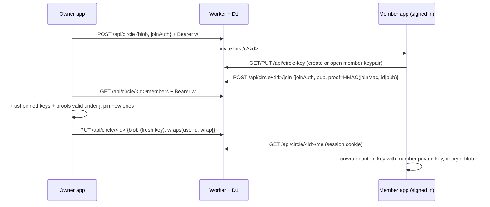

# Circle members with their own accounts

> updated 2026-10-11 · v2.1.0

A circle shares one profile live and read-only. New circles admit **members**: people with their own OAK account who join from an invite link. Each publish encrypts the snapshot with a fresh content key and wraps that key to every verified member's public key. Removing one member cuts them off from the next publish; the others keep reading. Older **bearer** circles (key in the link `#fragment`) keep working unchanged.

Code: `lib/member-keys.ts` (pure crypto, tested in `tests/circles.test.ts`), `lib/circles.ts` (client flows), `worker/circles.ts` (API), `components/circle-view.tsx` (`/c/`), Settings → Circles.

## Keys

| Key | Made by | Stored | Server sees |
| --- | --- | --- | --- |
| Member keypair (ECDH P-256), one per account | member's first join or read | `member_keys`: public key (raw point, b64u) + private JWK sealed with AES-GCM | public key, ciphertext |
| Member seal key | HKDF(sync key, salt `oak-healthy-v1`, info `member-key`) | nowhere, derived on each unlocked device | never |
| Invite secret `j` (24 random bytes) | owner, per circle; replaced on every member removal | owner device (`meta.circles`), invite link `#j=` | never |
| `joinAuth` = HKDF(j, `join-auth`) | owner / joiner | `circles.join_hash` = SHA-256(joinAuth) | joinAuth in transit, hash at rest |
| `joinMac` = HKDF(j, `join-mac`) | owner / joiner | nowhere | never |
| Content key (AES-256-GCM) | owner, **new on every publish** | nowhere in plaintext | never |
| Wrap = ECIES(ephemeral P-256 × member pub → HKDF info `wrap:<circle>:<epk>` → AES-GCM) | owner | `circle_members.wrap` (`epk.iv.ct`) | ciphertext |
| Write token `w` | owner | owner device; server keeps SHA-256 | hash |

The private member key is sealed with a key derived from the OAK sync key, so every device where the account is unlocked can open it and the server cannot.

## Flows

- **Join**: needs a session and the invite link. The page drops the `#j=` fragment after joining; from then on `/c/<id>` reads with the session cookie, no key in the URL. Until the owner's next publish the member sees "waiting". Opening Settings on the owner device publishes right away when someone is waiting.
- **Publish**: the sync agent publishes every circle after local changes. Members not in `wraps` get `wrap = NULL` in the same batch.
- **Remove member**: the owner first re-reads its stored circle and the server's member list and pins every other member whose key is pinned or proven under the **current** `j` (joins not yet published-in included). Then `POST /revoke` deletes the row and replaces `join_hash` (a new `j`), and the owner publishes with a new content key. Unused invite links stop working; copy the new one.
- **Delete circle**: `DELETE /api/circle/<id>` removes the circle and all member rows.
- **Bearer circles**: `join_hash IS NULL`. `GET /api/circle/<id>` stays public and returns the blob for the `#key` holder. Member circles answer that route with 403.

## Threat model

| Attacker | Gets | Does not get |
| --- | --- | --- |
| Server / D1 dump | ciphertext, member public keys, member emails (from `users`), who is in which circle, publish times | health data, any private or content key, `j`, `joinMac` |
| Malicious server adds its own key as a member | nothing: the owner wraps only to keys pinned earlier or carrying a valid `joinMac` proof, and the server never sees `joinMac` | |
| Malicious server swaps a pinned member's key | nothing: a pinned user's key must match the pin | |
| Removed member | the snapshots published before removal (already readable to them) | anything published after; the old invite link (replaced) |
| Someone with a leaked invite link (before it is replaced) | can join; the owner sees their email in Settings and can remove them | |

Open limits (accepted for v1):
- **Integrity against a malicious server**: a member cannot tell an owner-made snapshot from one the server forged with a key it wrapped to the member's public key. Confidentiality holds; authenticity of what a member sees relies on the server.
- **Owner state is per device**: `w`, `j` and pins live in the owner device's `meta.circles`, as before.
- **Sync key rotation** (password reset without recovery code): the stored member private key no longer opens. Reading never replaces it (the error asks for a new invite); only an explicit join creates a new keypair, so the member rejoins from a fresh invite link.
- **An invite link is a join capability**: anyone holding it can join with any account, and the owner app admits them on its next publish. The owner sees each member's email and can remove them.

Account deletion removes the account's `member_keys` and `circle_members` rows.

## Limits

- 20 members per circle; joins, key writes: 20 per account per hour; circle creation: 20 per IP per hour.
- Blob ≤ 400 000 chars; wrap 100–400; public key 80–100; proof 40–50; sealed key ≤ 2000.
- All `/api/circle*` writes require a same-origin `Origin` header, as `/api/auth`.

## Migration

`worker/migrations/0004_circle_members.sql` adds `circles.join_hash`, `member_keys` and `circle_members`. Existing rows get `join_hash = NULL` and stay bearer circles; no client change is needed for them. New invites from Settings are member circles.
